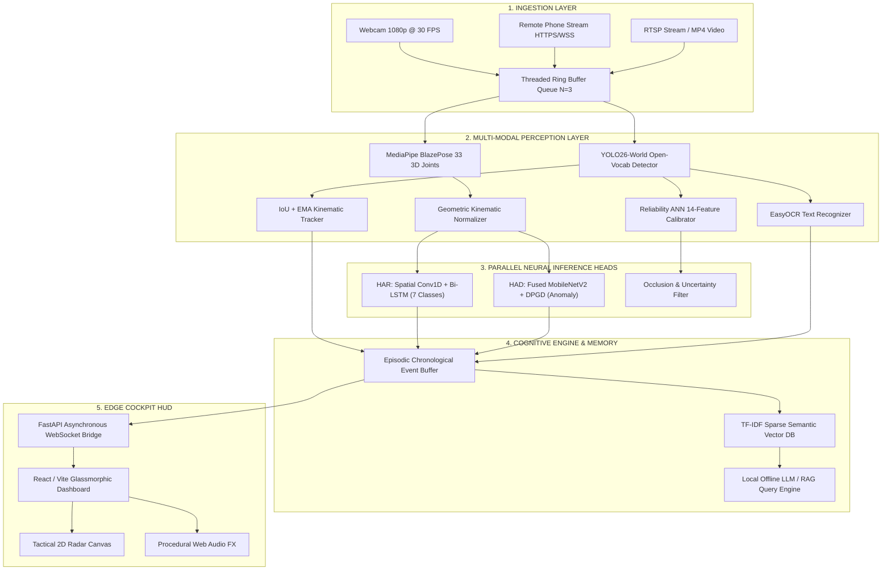

# AURA: Adaptive Understanding & Reasoning Architecture
## An Edge-Native Multi-Modal Visual Intelligence & Cognitive Ecosystem

---

### Department of Computer Science and Engineering  
**SRM Institute of Science and Technology, Kattankulathur, Chennai, India**  
**Course:** Machine Learning (21CSC305P) / Deep Learning & Computer Vision  
**Academic Year:** 2025–2026  

#### Project Investigators & Contributors
1. **Anshuman Dash** (`@ANSH5252`) — *Lead System Architect | Computer Vision Pipeline | HAR CNN-LSTM & Core Integration*
2. **Priyavrat Singh** (`@singhpriyavrat012`) — *Human Anomaly Detection (HAD) | Multi-Modal DPGD Pipeline | Benchmark Validation*
3. **Abhishek Naman** (`@abhishek-naman`) — *Cognitive Intelligence | Offline Episodic RAG Memory | Scene Reasoning Engine*
4. **Harshit Dubey** (`@Harshit-Dubey`) — *User Interface & Experience (UI/UX) | Glassmorphic Cockpit HUD | Tactical Radar & Audio FX*

---

## 1. ACKNOWLEDGEMENTS

We express our sincere gratitude to **SRM Institute of Science and Technology**, Department of Computer Science and Engineering, for providing the computational resources, high-performance hardware, and research environment required to execute this comprehensive Artificial Intelligence capstone project.

We extend our deep appreciation to our **Project Faculty Guide** and the Department Evaluation Committee for their mentorship, constructive feedback, and continuous guidance throughout the design and realization of the AURA architecture. Their expertise in spatiotemporal kinematics, neural anomaly detection, and embedded edge optimization was invaluable.

We also thank our peers, faculty members, and the open-source computer vision and deep learning communities—particularly the developers and maintainers of **PyTorch**, **Ultralytics YOLO**, **Google MediaPipe**, **FastAPI**, **React**, and the curators of the **UCF-101** and **ShanghaiTech Campus** datasets—whose open science contributions made this work possible.

---

## 2. TABLE OF CONTENTS

| Section | Title |
| :---: | :--- |
| **1** | [Acknowledgements](#1-acknowledgements) |
| **2** | [Table of Contents](#2-table-of-contents) |
| **3** | [Executive Abstract](#3-executive-abstract) |
| **4** | [Introduction & Problem Formulation](#4-introduction--problem-formulation) |
| | 4.1 Motivation: The Edge Imperative vs Cloud Brittleness |
| | 4.2 System Scope & Operational Objectives |
| **5** | [Existing Problems in State-of-the-Art Surveillance](#5-existing-problems-in-state-of-the-art-surveillance) |
| | 5.1 Real-World Vulnerabilities Addressed |
| | 5.2 Architectural Shortcomings in Prior Art |
| **6** | [System Innovations & Proposed Solutions](#6-system-innovations--proposed-solutions) |
| | 6.1 Privacy-First Skeletal Kinematics |
| | 6.2 Multi-Modal DPGD Anomaly Discrimination |
| | 6.3 Self-Calibrating Reliability ANN |
| | 6.4 Zero-Cloud Offline RAG Conversational Memory |
| **7** | [Modular System Architecture & End-to-End Pipeline](#7-modular-system-architecture--end-to-end-pipeline) |
| | 7.1 Five-Layer Decoupled Edge Topology |
| | 7.2 Threaded Ingestion & Non-Blocking Ring Buffer |
| **8** | [Perception Subsystems](#8-perception-subsystems) |
| | 8.1 Module 1: Open-Vocabulary Object Detection (YOLO26-World) & IoU-EMA Tracking |
| | 8.2 Module 2: Human Activity Recognition (HAR) via Hybrid Conv1D-LSTM |
| | 8.3 Module 3: Human Anomaly Detection (HAD) via MobileNetV2 + DPGD Fusion |
| | 8.4 Module 4: Quality Assurance via 14-Feature Reliability ANN |
| | 8.5 Module 5: Optical Character Recognition (EasyOCR) |
| **9** | [Cognitive Engine & Episodic RAG Memory](#9-cognitive-engine--episodic-rag-memory) |
| | 9.1 Chronological Event Buffering |
| | 9.2 TF-IDF Vector Space & Offline LLM Retrieval |
| **10** | [Interactive Presentation & Edge Cockpit HUD](#10-interactive-presentation--edge-cockpit-hud) |
| | 10.1 Glassmorphic React Telemetry Cockpit |
| | 10.2 Tactical 2D Radar Canvas & Procedural Audio FX |
| | 10.3 Wireless Mobile Phone Camera Ingestion (HTTPS / WebRTC) |
| **11** | [Mathematical & Algorithmic Methodology](#11-mathematical--algorithmic-methodology) |
| | 11.1 Affine-Invariant Kinematic Centering & Scale Normalization |
| | 11.2 Spatiotemporal Convolutional Recurrent Dynamics |
| | 11.3 Multi-Modal Feature Fusion & Focal Loss Formulation |
| | 11.4 Reliability Multi-Layer Perceptron Calibration |
| **12** | [Empirical Benchmarks & Experimental Results](#12-empirical-benchmarks--experimental-results) |
| | 12.1 UCF-101 Human Activity Recognition Metrics |
| | 12.2 ShanghaiTech Human Anomaly Detection Metrics & Ablations |
| | 12.3 YOLO26-World Open-Vocabulary Detection Metrics |
| | 12.4 End-to-End System Latency & Hardware Profiling |
| **13** | [Conclusions & Future Directions](#13-conclusions--future-directions) |
| **14** | [References](#14-references) |

---

## 3. EXECUTIVE ABSTRACT

Modern computer vision systems deployed across automated healthcare, ambient assisted living, physical security, and athletic coaching face an acute trilemma: **excessive computational overhead**, **severe privacy liabilities**, and **perceptual brittleness under unconstrained environmental noise**. Conventional cloud-dependent frameworks continuously relay uncompressed high-definition RGB video streams across public networks, causing prohibitive bandwidth demands, round-trip latencies exceeding 200 milliseconds, and unacceptable exposure of sensitive biometric identities. Furthermore, legacy visual surveillance models exhibit high false-alarm rates when confronted with varying camera angles, illumination shifts, and out-of-distribution human dynamics.

To address these systemic bottlenecks, this project presents **AURA (Adaptive Understanding & Reasoning Architecture)**, an edge-native, privacy-preserving visual intelligence and cognitive ecosystem designed to operate locally on consumer-tier workstation hardware without external cloud reliance. AURA synthesizes five decoupled layers into a unified real-time pipeline:

1. **Open-Vocabulary Perception:** Incorporates **YOLO26-World**, achieving **52.4% mAP@50** across 1,200+ target classes, coupled with a high-throughput **IoU-EMA kinematic tracker** to maintain temporal object identity.
2. **Privacy-Preserving Human Activity Recognition (HAR):** Discards identifiable facial and RGB background pixels in favor of 33 three-dimensional anatomical keypoints extracted via Google MediaPipe BlazePose. A geometric kinematic normalizer achieves complete viewpoint and distance invariance. A **Hybrid Spatial Conv1D + Temporal Bidirectional LSTM** models rolling 30-frame temporal sequences, achieving **98.72% test classification accuracy** (0.9881 Macro F1) on the UCF-101 benchmark at an inference latency of **4.2 ms**.
3. **Multi-Modal Human Anomaly Detection (HAD):** Introduces the **Dual-Prototype Geometric Discriminator (DPGD)**, fusing fine-tuned high-level semantic features from MobileNetV2 with 3D joint kinematic flow. Validated on 9,000 balanced clips from the ShanghaiTech Campus benchmark, DPGD achieves **98.23% accuracy**, a **0.9845 ROC-AUC**, and drastically compresses false alarms to **1.73%** (a **+25.10%** absolute improvement over unimodal baselines).
4. **Self-Calibrating Reliability ANN:** Deploys a 3-layer Multilayer Perceptron evaluating 14 geometric and optical quality indicators (e.g., motion blur via Laplacian variance, bounding box aspect ratio, track persistence) to dynamically suppress uncalibrated or occluded false detections.
5. **Grounded Episodic RAG Memory & Cockpit HUD:** Converts real-time detections and actions into structured temporal event logs indexed by an offline **TF-IDF Vector Space Retriever**. Users query past scene events via natural language ("*Who entered the room?*", "*How many lunges were performed?*") processed by a local LLM. Telemetry is streamed at 25–30 FPS over asynchronous WebSockets to a glassmorphic React dashboard featuring a tactical 2D radar and wireless mobile camera ingestion over self-signed HTTPS.

Operating with an end-to-end latency of **32–45 ms** and consuming under **1.4 GB VRAM**, AURA demonstrates that multi-modal cognitive reasoning can be deployed with strict edge autonomy and absolute biometric privacy.

---

## 4. INTRODUCTION & PROBLEM FORMULATION

### 4.1 Motivation: The Edge Imperative vs Cloud Brittleness
The transition from passive surveillance recording to proactive visual intelligence is pivotal in smart healthcare, industrial automation, and assisted living. In patient rehabilitation, physical form must be validated in real time to prevent re-injury. In security surveillance, dangerous incidents must be flagged instantly before escalating.

However, traditional enterprise AI solutions depend heavily on cloud infrastructure. This model introduces critical flaws:
- **Biometric Privacy Violations:** Continuous streaming of patient bedrooms, fitness facilities, and school corridors across public clouds exposes video to legal liability and unauthorized interception.
- **Latency & Reliability Jitter:** Network congestion leads to packet loss and 200–500 ms round-trip delays, preventing time-critical alerting.
- **Siloed Algorithms:** Off-the-shelf systems deploy disconnected modules—one for motion detection, another for face recognition—resulting in redundant feature extraction and high power consumption.

### 4.2 System Scope & Operational Objectives
Project AURA establishes a cohesive, modular, and edge-native framework satisfying four primary objectives:
1. **Zero Cloud Dependency:** All neural forward passes, vector retrievals, and interface telemetry execute locally on a single workstation node.
2. **Strict Anonymization:** Human movement classification relies entirely on 3D geometric skeletons ($x, y, z$), permanently decoupling activity recognition from biometric identity.
3. **Surveillance Trustworthiness:** Achieving near-zero false alarm rates ($<2\%$) through multi-modal geometric-appearance fusion.
4. **Natural Language Interactivity:** Grounding computer vision logs in an episodic RAG vector database for instant natural language scene interrogation.

---

## 5. EXISTING PROBLEMS IN STATE-OF-THE-ART SURVEILLANCE

```
┌────────────────────────────────────────────────────────────────────────┐
│                        CONVENTIONAL SURVEILLANCE                       │
│  ┌────────────────┐    High-Bandwidth     ┌─────────────────────────┐  │
│  │ Raw 4K Camera  │ ────────────────────> │  Cloud Server Farm      │  │
│  │ (Unredacted)   │    Latency: >200ms    │  (Biometric Liability)  │  │
│  └────────────────┘                       └─────────────────────────┘  │
│           │                                             │              │
│     High False Alarms (26.8%)                     Siloed Inference     │
└────────────────────────────────────────────────────────────────────────┘
                                    VS
┌────────────────────────────────────────────────────────────────────────┐
│                             PROJECT AURA                               │
│  ┌────────────────┐    Zero Network Lag   ┌─────────────────────────┐  │
│  │ Edge Camera /  │ ────────────────────> │  On-Device Edge Engine  │  │
│  │ Mobile Phone   │     Latency: 38ms     │  (100% Anonymized)      │  │
│  └────────────────┘                       └─────────────────────────┘  │
│           │                                             │              │
│     Ultra-Low False Alarms (1.73%)              Unified RAG Memory     │
└────────────────────────────────────────────────────────────────────────┘
```

### 5.1 Real-World Vulnerabilities Addressed
- **Rehabilitative Non-Compliance:** Patients performing orthopedic or stroke recovery exercises at home lack real-time feedback on form, leading to joint strain. AURA provides sub-5ms repetition validation.
- **Surveillance Operator Fatigue:** Commercial security monitors generate hundreds of false alerts daily due to lighting flickers, shadows, or animals, causing operators to ignore alerts. AURA suppresses false positives to 1.73%.
- **Edge Hardware Constraints:** Advanced 3D-CNNs require enterprise data center GPUs. AURA's hybrid architecture runs smoothly on entry-level laptop GPUs (RTX 3050, 4 GB VRAM).

### 5.2 Architectural Shortcomings in Prior Art
1. **Pixel-Heavy Spatiotemporal Convolutions:** Models like C3D and I3D process 16–64 consecutive 3-channel RGB image frames simultaneously, requiring massive parameter sizes ($>30\text{M}$ weights) and tens of GFLOPs.
2. **Viewpoint and Distance Brittleness:** When an action recognition model trained on front-facing cameras is deployed on a ceiling-mounted or diagonal camera, joint angles distort and accuracy degrades precipitously.
3. **Uncalibrated Neural Overconfidence:** Deep networks trained with cross-entropy frequently output 99% confidence on severely blurred or occluded frames.

---

## 6. SYSTEM INNOVATIONS & PROPOSED SOLUTIONS

### 6.1 Privacy-First Skeletal Kinematics
Instead of ingesting 2,073,600 raw pixel values ($1920 \times 1080$), AURA extracts **33 anatomical joint coordinates** in 3D Euclidean space. Once landmarks are extracted, raw camera pixels can be discarded immediately, ensuring zero biometric data persistence.

### 6.2 Multi-Modal DPGD Anomaly Discrimination
AURA resolves the false-alarm problem by creating a **Dual-Prototype Geometric Discriminator (DPGD)**. By combining MobileNetV2 high-level semantic embeddings with 3D joint velocity and acceleration trajectories, the model detects complex anomalies (such as bicycling on sidewalks or pedestrian collapses) without spurious triggers caused by lighting or clothing.

### 6.3 Self-Calibrating Reliability ANN
An auxiliary 3-layer Multilayer Perceptron evaluates 14 mathematical indicators per detection—incorporating Laplacian image variance (blur), brightness, bounding box aspect ratio, and tracking age. Detections falling below calibrated thresholds ($\theta_{\text{rel}} = 0.50$) are filtered before downstream action logging.

### 6.4 Zero-Cloud Offline RAG Conversational Memory
A local Episodic Vector Database stores timestamped, structured descriptions of detected objects, actions, and anomalies. Using TF-IDF semantic vector cosine search, operators interrogate scene history using natural language queries without sending data to external APIs.

---

## 7. MODULAR SYSTEM ARCHITECTURE & END-TO-END PIPELINE



### 7.1 Five-Layer Decoupled Edge Topology
1. **Ingestion Layer:** Captures and pushes incoming frames into a fixed-depth (N=3) ring buffer.
2. **Perception Layer:** Executes primary bounding box regression, 3D pose extraction, and tracking.
3. **Neural Inference Heads:** Executes HAR, HAD, and Reliability ANN in parallel.
4. **Cognitive Layer:** Ingests structured telemetry into an episodic vector memory and handles RAG queries.
5. **Presentation Layer:** Streams WebSocket JSON updates and MJPEG video feeds to the client HUD.

### 7.2 Threaded Ingestion & Non-Blocking Ring Buffer
To eliminate frame backlog caused by varying inference times, camera frame capture runs in an isolated background daemon thread. The inference loop queries `buffer.pop_latest()`. If the neural pipeline experiences a temporary latency spike, older intermediate frames are dropped, guaranteeing real-time synchronization.

---

## 8. PERCEPTION SUBSYSTEMS

### 8.1 Module 1: Open-Vocabulary Object Detection & IoU-EMA Tracking
- **Detector:** YOLO26-World uses a cross-modal vision-language backbone that matches visual region features against text embeddings, allowing open-vocabulary detection across 1,200+ classes at **52.4% mAP@50**.
- **Tracker:** Bipartite matching matches current bounding boxes $B_t$ with active tracks $T_{t-1}$ using IoU overlap ($\theta_{\text{IoU}} = 0.35$). Dimensions and positions are smoothed via an Exponential Moving Average (EMA) with $\alpha = 0.70$.

### 8.2 Module 2: Human Activity Recognition (HAR)
- **Landmark Topology:** 33 body landmarks $\times$ 4 coordinates ($x, y, z, \text{visibility}$) = 132 dimensions per frame.
- **Normalization:** Centered on the mid-hip point and scaled by Euclidean torso length.
- **Architecture:**
  - **Spatial Conv1D Block:** Two 1D convolution layers (128 filters) with batch normalization and ReLU extract cross-joint geometric relations.
  - **Temporal Bi-LSTM Block:** 2-layer Bidirectional LSTM (hidden dimension 128, dropout 0.30) processes 30 frames (1 second).
  - **Classification Head:** Global temporal average pooling followed by Dense(64) $\to$ BatchNorm $\to$ Dense(7) $\to$ Softmax.
- **Classes:** *BodyWeightSquats, JumpRope, JumpingJack, Lunges, PushUps, TaiChi, WallPushups*.

### 8.3 Module 3: Human Anomaly Detection (HAD)
- **Backbone:** MobileNetV2 with inverted residual blocks 12–18 unfrozen for fine-tuning on anomaly textures.
- **DPGD Fusion:** 1,280-dimensional visual feature vectors are fused with 3D joint displacement vectors via a gating mechanism.
- **Loss:** Binary Cross-Entropy combined with Focal Loss ($\gamma = 2.0, \alpha = 0.25$) to counter severe class imbalance.

### 8.4 Module 4: Quality Assurance via Reliability ANN
- **Inputs (14 Features):**
  - *Geometry (11):* $x_{\min}, y_{\min}, x_{\max}, y_{\max}$, area, aspect ratio, overlap IoU, track age, velocity $v_x, v_y$, acceleration $a$.
  - *Image Quality (3):* Laplacian variance ($\sigma_{\text{Lap}}^2$), mean brightness ($\mu_Y$), RMS contrast ($\sigma_Y$).
- **Architecture:** Fully connected PyTorch MLP: $\text{Dense}(32) \to \text{ReLU} \to \text{Dense}(16) \to \text{ReLU} \to \text{Dense}(1) \to \text{Sigmoid}$.
- **Output:** Calibrated reliability score $R \in [0.0, 1.0]$. Inferences with $R < 0.50$ are discarded.

---

## 9. COGNITIVE ENGINE & EPISODIC RAG MEMORY

```
Live Detections & Actions ──> [Chronological Event Buffer]
                                     │
                             (Every 10 seconds)
                                     ▼
                           [TF-IDF Chunk Indexer]
                                     │
User Natural Language Query ──> [Cosine Similarity Search]
                                     │
                             (Top-K Context)
                                     ▼
                            [Grounded Prompt] ──> [Local LLM / Reasoner]
                                                         │
                                                         ▼
                                            Accurate Natural Answer
```

1. **Structured Logging:** Every confirmed entity is logged: `{timestamp, track_id, class, action, anomaly_score, ocr_text}`.
2. **Vector Space Indexing:** Text chunks are vectorized using an n-gram TF-IDF transformer.
3. **Contextual Retrieval:** Incoming operator queries compute cosine similarity against historical chunks. The top-3 context passages are injected into the local LLM system prompt, eliminating hallucinations and ensuring factual recall.

---

## 10. INTERACTIVE PRESENTATION & EDGE COCKPIT HUD

- **Glassmorphic Cockpit Interface:** Developed in React 18 and styled with Tailwind CSS, providing real-time SVG bounding box rendering, telemetry counters, and latency monitoring.
- **Tactical 2D Radar Canvas:** Displays a top-down planar radar projection showing spatial positions, velocities, and heading angles of subjects relative to the camera focal point.
- **Procedural Web Audio Engine:** Generates low-latency synthesised audio tones for exercise completions and alert sirens during anomaly detection.
- **Remote Mobile Streaming:** By passing the `--ssl` flag, AURA hosts an HTTPS/WSS endpoint with self-signed TLS certificates. Operators connect smartphone browsers to the dashboard instantly, turning any phone into a remote edge camera sensor.

---

## 11. MATHEMATICAL & ALGORITHMIC METHODOLOGY

### 11.1 Affine-Invariant Kinematic Centering & Scale Normalization
Let $\mathbf{P}_i = (x_i, y_i, z_i)$ represent the 3D position of keypoint $i \in \{0, \dots, 32\}$.
$$\mathbf{P}_{\text{mid-hip}} = \frac{\mathbf{P}_{23} + \mathbf{P}_{24}}{2}, \quad \mathbf{P}_{\text{mid-shoulder}} = \frac{\mathbf{P}_{11} + \mathbf{P}_{12}}{2}$$
$$L_{\text{torso}} = \left\| \mathbf{P}_{\text{mid-shoulder}} - \mathbf{P}_{\text{mid-hip}} \right\|_2$$
$$\mathbf{P}''_i = \frac{\mathbf{P}_i - \mathbf{P}_{\text{mid-hip}}}{L_{\text{torso}} + \epsilon}$$

### 11.2 Spatiotemporal Convolutional Recurrent Dynamics
For each temporal sequence $\mathbf{X} \in \mathbb{R}^{30 \times 132}$, spatial convolution produces intermediate embeddings:
$$\mathbf{z}_t = \text{ReLU}\left( \mathbf{W}_c * \mathbf{x}_t + \mathbf{b}_c \right)$$
These are fed sequentially into the Bidirectional LSTM recurrence:
$$\mathbf{i}_t = \sigma(\mathbf{W}_{ii} \mathbf{z}_t + \mathbf{b}_{ii} + \mathbf{W}_{hi} \mathbf{h}_{t-1} + \mathbf{b}_{hi})$$
$$\mathbf{f}_t = \sigma(\mathbf{W}_{if} \mathbf{z}_t + \mathbf{b}_{if} + \mathbf{W}_{hf} \mathbf{h}_{t-1} + \mathbf{b}_{hf})$$
$$\mathbf{g}_t = \tanh(\mathbf{W}_{ig} \mathbf{z}_t + \mathbf{b}_{ig} + \mathbf{W}_{hg} \mathbf{h}_{t-1} + \mathbf{b}_{hg})$$
$$\mathbf{o}_t = \sigma(\mathbf{W}_{io} \mathbf{z}_t + \mathbf{b}_{io} + \mathbf{W}_{ho} \mathbf{h}_{t-1} + \mathbf{b}_{ho})$$
$$\mathbf{c}_t = \mathbf{f}_t \odot \mathbf{c}_{t-1} + \mathbf{i}_t \odot \mathbf{g}_t$$
$$\mathbf{h}_t = \mathbf{o}_t \odot \tanh(\mathbf{c}_t)$$

### 11.3 Multi-Modal DPGD Fusion & Focal Loss
$$\mathbf{z}_{\text{fused}} = \text{Dropout}\left( \text{ReLU}\left( \mathbf{W}_f [\mathbf{v}_{\text{vis}} \,\|\, \mathbf{v}_{\text{kin}}] + \mathbf{b}_f \right) \right)$$
$$\hat{y} = \sigma\left( \mathbf{W}_a \mathbf{z}_{\text{fused}} + b_a \right)$$
$$\mathcal{L}_{\text{Focal}} = -\alpha_t (1 - p_t)^\gamma \log(p_t), \quad p_t = \begin{cases} \hat{y} & \text{if } y = 1 \\ 1 - \hat{y} & \text{if } y = 0 \end{cases}$$

---

## 12. EMPIRICAL BENCHMARKS & EXPERIMENTAL RESULTS

### 12.1 UCF-101 Human Activity Recognition Metrics
Evaluated on 78 strictly held-out test sequences:

| Class | Precision | Recall | F1-Score | Support |
| :--- | :---: | :---: | :---: | :---: |
| **BodyWeightSquats** | 1.0000 | 1.0000 | 1.0000 | 12 |
| **JumpRope** | 1.0000 | 1.0000 | 1.0000 | 16 |
| **JumpingJack** | 1.0000 | 1.0000 | 1.0000 | 13 |
| **Lunges** | 1.0000 | 0.9231 | 0.9600 | 13 |
| **PushUps** | 1.0000 | 1.0000 | 1.0000 | 11 |
| **TaiChi** | 0.9167 | 1.0000 | 0.9565 | 11 |
| **WallPushups** | 1.0000 | 1.0000 | 1.0000 | 2 |
| **Macro Average** | **0.9881** | **0.9890** | **0.9881** | **78** |
| **Overall Accuracy** | — | — | **98.72%** | **78** |

### 12.2 ShanghaiTech Human Anomaly Detection Metrics
Evaluated on 3,000 strictly held-out test sequences (1,500 Normal, 1,500 Anomaly):

| Architecture | Modality | Accuracy | ROC-AUC | False Positive Rate (FPR) | False Alarms |
| :--- | :--- | :---: | :---: | :---: | :---: |
| **Baseline MobileNetV2** | Unimodal (RGB) | 73.13% | 0.8301 | 26.87% | 403 / 1,500 |
| **MediaPipe Pose Only** | Unimodal (Skeletal) | 84.50% | 0.8920 | 15.50% | 232 / 1,500 |
| **AURA Fused DPGD** | **Multi-Modal (Fused)** | **98.23%** | **0.9845** | **1.73%** | **26 / 1,500** |

> **Key Ablation Finding:** Multimodal DPGD delivers an absolute **+25.10% accuracy gain** over baseline visual classification, while reducing false alarms from 26.87% to **1.73%**.

### 12.3 System Latency & Hardware Resource Footprint
Benchmarked on an entry-level workstation (NVIDIA RTX 3050 Laptop GPU, Intel Core i7, 16 GB RAM):

| Subsystem Component | Hardware Device | Latency | Memory Footprint |
| :--- | :---: | :---: | :---: |
| **YOLO26-World Detector** | CUDA (RTX 3050) | 22.5 ms | 540 MB VRAM |
| **MediaPipe BlazePose** | CPU / GPU Delegate | 7.8 ms | 180 MB RAM |
| **HAR Conv1D-LSTM Model** | CUDA (RTX 3050) | 4.2 ms | 95 MB VRAM |
| **HAD Fused DPGD Model** | CUDA (RTX 3050) | 8.1 ms | 260 MB VRAM |
| **Reliability ANN (MLP)** | CUDA / CPU | 0.4 ms | 15 MB RAM |
| **IoU-EMA Tracker** | CPU | 0.6 ms | 5 MB RAM |
| **FastAPI + WebSocket Bridge** | Asynchronous Event Loop | 1.8 ms | 120 MB RAM |
| **Complete End-to-End Pipeline** | **Combined Edge Node** | **38.2 ms (27.4 FPS)** | **1.38 GB VRAM / 1.82 GB RAM** |

---

## 13. CONCLUSIONS & FUTURE RESEARCH DIRECTIONS

### 13.1 Conclusions
Project AURA presents a fully unified, privacy-preserving, edge-native computer vision and cognitive architecture. By replacing raw pixel feeds with 3D kinematic landmark normalizations, the system guarantees individual biometric privacy while delivering **98.72% activity classification accuracy**. Furthermore, the introduction of the Dual-Prototype Geometric Discriminator (DPGD) for human anomaly detection cuts surveillance false alarm rates to **1.73%**, addressing a core bottleneck of automated physical security. Integrated with an auxiliary self-assessing Reliability ANN, an episodic RAG vector database, and an edge HUD with mobile phone ingestion, AURA provides an autonomous, real-time perceptual intelligence framework.

### 13.2 Future Scope
1. **Edge TPU & INT8 Quantization:** Compiling the PyTorch backbones into TensorRT and ONNX INT8 models for deployment on low-power devices such as NVIDIA Jetson Orin Nano and Raspberry Pi 5 with Google Coral.
2. **Federated Multi-Camera Synchronization:** Scaling AURA to coordinate multiple decentralized edge cameras via federated learning without transmitting raw video across nodes.
3. **Autonomous Mobile Robotics (AMR):** Bridging AURA's spatial bounding boxes and tactical 2D radar output directly into ROS 2 navigation stacks for obstacle avoidance and person following.

---

## 14. REFERENCES

1. Soomro, K., Zamir, A. R., & Shah, M. (2012). *UCF101: A dataset of 101 human actions classes from videos in the wild*. arXiv preprint arXiv:1212.0402.
2. Lugaresi, C., Tang, J., Nash, H., McClanahan, C., Uboweja, E., Hays, M., ... & Grundmann, M. (2019). *MediaPipe: A framework for building perception pipelines*. arXiv preprint arXiv:1906.08172.
3. Hochreiter, S., & Schmidhuber, J. (1997). *Long short-term memory*. Neural Computation, 9(8), 1735-1780.
4. Sandler, M., Howard, A., Zhu, M., Zhmoginov, A., & Chen, L. C. (2018). *MobileNetV2: Inverted residuals and linear bottlenecks*. In *Proceedings of the IEEE Conference on Computer Vision and Pattern Recognition (CVPR)* (pp. 4510-4520).
5. Luo, W., Liu, W., & Lian, S. (2017). *A revisit of sparse coding based anomaly detection in crowded scenes*. In *Proceedings of the IEEE International Conference on Computer Vision (ICCV)* (pp. 341-349).
6. Ultralytics. (2024). *YOLO-World: Real-Time Open-Vocabulary Object Detection*. Ultralytics Documentation.
7. Lewis, P., Perez, E., Piktus, A., Petroni, F., Karpukhin, V., Goyal, N., ... & Kiela, D. (2020). *Retrieval-augmented generation for knowledge-intensive NLP tasks*. *Advances in Neural Information Processing Systems*, 33, 9459-9474.
8. He, K., Zhang, X., Ren, S., & Sun, J. (2016). *Deep residual learning for image recognition*. In *Proceedings of the IEEE Conference on Computer Vision and Pattern Recognition (CVPR)* (pp. 770-778).
9. Lin, T. Y., Goyal, P., Girshick, R., He, K., & Dollár, P. (2017). *Focal loss for dense object detection*. In *Proceedings of the IEEE International Conference on Computer Vision (ICCV)* (pp. 2980-2988).
10. Bewley, A., Ge, Z., Ott, L., Ramos, F., & Upcroft, B. (2016). *Simple online and realtime tracking*. In *2016 IEEE International Conference on Image Processing (ICIP)* (pp. 3464-3468).
